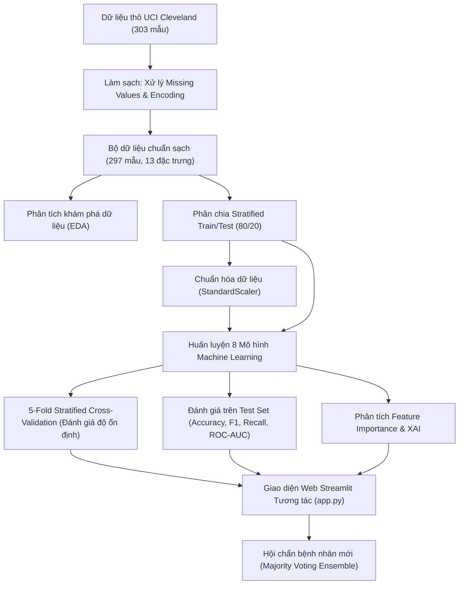

# 🫀 ĐỒ ÁN HỌC MÁY: HỆ THỐNG DỰ ĐOÁN & CHẨN ĐOÁN BỆNH TIM BẰNG 8 THUẬT TOÁN MACHINE LEARNING

> **Môn học:** Học Máy (Machine Learning)  
> **Đề tài:** Ứng dụng các thuật toán Học máy trong phân loại và chẩn đoán nguy cơ bệnh tim mạch dựa trên dữ liệu lâm sàng thực tế  
> **Bộ dữ liệu:** UCI Heart Disease (Cleveland Clinic Foundation - 297 bệnh nhân thực tế)  
> **Nền tảng triển khai:** Python 3.x, Scikit-Learn, XGBoost, Streamlit  

---

## 👥 PHÂN CHIA NHIỆM VỤ THÀNH VIÊN NHÓM (3 THÀNH VIÊN)

Dự án được phân bổ cân bằng và khoa học theo **3 trụ cột chuyên môn** nhằm đảm bảo mỗi thành viên phụ trách các trường phái thuật toán rõ ràng, hiểu sâu cơ chế toán học và làm chủ mô-đun mã nguồn tương ứng:

| STT | Thành Viên | Vai Trò (Role) | Thuật Toán Phụ Trách | Trách Nhiệm Mô-đun Hệ Thống | Tỉ Lệ Đóng Góp |
| :---: | :--- | :--- | :--- | :--- | :---: |
| 1 | **Thành viên 1** *(Nhóm trưởng)* | **Baseline & Linear-Probabilistic Architect** | 1. **Logistic Regression**<br>2. **Naive Bayes**<br>3. **Decision Tree** | • Pipeline dữ liệu chuẩn UCI & `StandardScaler`<br>• Module **🏠 Tổng Quan Dự Án**<br>• Module **📊 Khám Phá Dữ Liệu (EDA)** | **33.3%** |
| 2 | **Thành viên 2** | **Geometry, Kernel & Validation Lead** | 4. **K-Nearest Neighbors (KNN)**<br>5. **Support Vector Machine (SVM)**<br>6. **Gradient Boosting (GB)** | • Đánh giá kiểm định chéo **5-Fold Stratified CV**<br>• Biểu đồ phân tán sai số Boxplot qua các Folds<br>• Module **📈 Đường Cong ROC** & **🔢 Confusion Matrix** | **33.3%** |
| 3 | **Thành viên 3** | **Advanced Ensemble & Clinical AI Lead** | 7. **Random Forest (RF)**<br>8. **XGBoost (Extreme Boosting)**<br>9. **Majority Voting Ensemble** | • Phân tích **⭐ Feature Importance & XAI**<br>• Module **🩺 Chẩn Đoán Bệnh Nhân Mới** (Hội chẩn AI)<br>• Tổng hợp báo cáo học thuật & Slide bảo vệ | **33.4%** |

---

### 🔍 CHI TIẾT THUẬT TOÁN & MÔ-ĐUN THEO TỪNG THÀNH VIÊN

#### 🧑‍💻 1. THÀNH VIÊN 1: Nhóm mô hình Tuyến tính, Xác suất & Cây nền tảng (Duy Tân)
* **Thuật toán phụ trách:**
  1. **Logistic Regression (LR):** Tiêu chuẩn vàng trong nghiên cứu y học dịch tễ. Ứng dụng hàm Sigmoid ánh xạ tổ hợp tuyến tính thành xác suất mắc bệnh $P \in [0, 1]$. Cung cấp hệ số trọng số chuẩn hóa $\beta_i$ giúp giải thích rõ yếu tố làm tăng rủi ro (hệ số dương) và yếu tố bảo vệ tim mạch (hệ số âm).
  2. **Naive Bayes (Gaussian NB):** Ứng dụng định lý xác suất Bayes với giả định các chỉ số sinh hiệu độc lập có điều kiện. Tính toán xác suất hậu nghiệm $P(\text{Bệnh tim} \mid X)$ cực kỳ nhanh, đóng vai trò mô hình tham chiếu xác suất nhị phân.
  3. **Decision Tree (DT):** Cây quyết định phân cấp theo chỉ số bất thuần Gini (Gini Impurity). Cung cấp phác đồ luật rẽ nhánh trực quan dạng `IF - THEN` giống chẩn đoán lâm sàng của bác sĩ, làm cột mốc đối chứng (Baseline) cho các mô hình Ensemble.
* **Kết quả thực nghiệm từ dự án:**
  * **Naive Bayes:** Test Accuracy: **90.00%** | 5-Fold CV: **80.17% ± 4.56%** | ROC-AUC: **0.9375** | Recall: **85.71%** | F1: **88.89%** *(Đạt Accuracy và F1 cao nhất trên tập Test)*.
  * **Logistic Regression:** Test Accuracy: **85.00%** | 5-Fold CV: **83.10% ± 6.44%** | ROC-AUC: **0.9531** | Recall: **85.71%** | F1: **84.21%** *(Đạt ROC-AUC cao nhất 0.9531 và điểm CV ổn định nhất 83.10%)*.
  * **Decision Tree:** Test Accuracy: **71.67%** | 5-Fold CV: **75.50% ± 3.87%** | ROC-AUC: **0.7204** | Recall: **57.14%** | F1: **65.31%**.
* **Mô-đun trong ứng dụng Streamlit (`app.py`):**
  * Mã nguồn định nghĩa mô hình: [`app.py` dòng 264 - 273 và dòng 286 - 289](file:///d:/DoAnHocMay/app.py#L264-L289).
  * Tiền xử lý dữ liệu & Chuẩn hóa: Hàm `get_prepared_data()` ([`app.py` dòng 382 - 395](file:///d:/DoAnHocMay/app.py#L382-L395)).
  * Module giao diện phụ trách: **`🏠 Tổng Quan Dự Án`** ([`app.py` dòng 415 - 540](file:///d:/DoAnHocMay/app.py#L415-L540)) và **`📊 Khám Phá Dữ Liệu (EDA)`** ([`app.py` dòng 545 - 846](file:///d:/DoAnHocMay/app.py#L545-L846)) với 4 Tab phân tích phân bố, tương quan Pearson và Boxplot.

---

#### 🧑‍💻 2. THÀNH VIÊN 2: Nhóm mô hình Hình học, Siêu phẳng Kernel & Kiểm định chéo (Quốc Bảo)
* **Thuật toán phụ trách:**
  4. **K-Nearest Neighbors (KNN):** Phân loại dựa trên độ tương đồng hình học trong không gian 13 chiều (Khoảng cách Euclidean sau khi chuẩn hóa `StandardScaler`). Dựa trên tư duy: *"Bệnh nhân có các chỉ số sinh hiệu tương tự nhau thì khả năng mắc bệnh tim như nhau"*.
  5. **Support Vector Machine (SVM):** Tìm siêu phẳng phân tách tối ưu có lề (Margin) cực đại với hàm nhân phi tuyến RBF (Radial Basis Function). Giúp xử lý các mối quan hệ ranh giới phi tuyến phức tạp giữa các chỉ số tim mạch.
  6. **Gradient Boosting (GB):** Thuật toán Boosting tuần tự. Mỗi cây quyết định nhỏ được huấn luyện để sửa chữa sai số (Residual Errors) của các cây trước đó theo chiều ngược hướng gradient của hàm mất mát.
* **Kết quả thực nghiệm từ dự án:**
  * **K-Nearest Neighbors (KNN):** Test Accuracy: **86.67%** | 5-Fold CV: **79.32% ± 7.73%** | ROC-AUC: **0.9358** | Recall: **82.14%** | F1: **85.19%** *(Xếp thứ 2 trên tập Test)*.
  * **Support Vector Machine (SVM):** Test Accuracy: **81.67%** | 5-Fold CV: **81.43% ± 6.35%** | ROC-AUC: **0.9487** | Recall: **78.57%** | F1: **80.00%**.
  * **Gradient Boosting:** Test Accuracy: **78.33%** | 5-Fold CV: **78.02% ± 4.72%** | ROC-AUC: **0.8873** | Recall: **75.00%** | F1: **76.36%**.
* **Mô-đun trong ứng dụng Streamlit (`app.py`):**
  * Mã nguồn định nghĩa mô hình: [`app.py` dòng 274 - 281 và dòng 290 - 293](file:///d:/DoAnHocMay/app.py#L274-L293).
  * Module Kiểm định chéo 5-Fold: **Tab 2: `🔄 Kiểm Định Chéo (Cross-Validation)`** ([`app.py` dòng 985 - 1105](file:///d:/DoAnHocMay/app.py#L985-L1105)) gồm biểu đồ Boxplot độ biến thiên qua 5 Folds và bảng thống kê chi tiết Fold 1 - Fold 5.
  * Module Đánh giá đường cong & Ma trận: **Tab 4: `📈 Đường Cong ROC`** và **Tab 5: `🔢 Confusion Matrix`** ([`app.py` dòng 1240 - 1320](file:///d:/DoAnHocMay/app.py#L1240-L1320)).

---

#### 🧑‍💻 3. THÀNH VIÊN 3: Nhóm mô hình Ensemble tối tân, Giải thích AI & Hội chẩn lâm sàng (Hoàng Bảo)
* **Thuật toán phụ trách:**
  7. **Random Forest (RF):** Tập hợp 100 cây quyết định độc lập theo cơ chế Bagging (Bootstrap Aggregation). Triệt tiêu nhược điểm quá khớp của cây quyết định đơn lẻ, có độ bền vững cao trước nhiễu và ngoại lai.
  8. **XGBoost (XGB):** Thuật toán tối ưu hóa tăng cường độ dốc bậc hai (Hessian) hiện đại nhất hiện nay. Tích hợp sẵn điều chuẩn hóa phạt L1/L2 (Regularization) trong hàm mục tiêu, giúp khai phá mẫu hình bệnh lý phức tạp.
  9. **Majority Voting Ensemble (Biểu quyết đa số):** Thuật toán Meta-Ensemble đóng vai trò như một *"Hội đồng hội chẩn đa chuyên khoa"*, tổng hợp kết quả của cả 8 thuật toán ML để ra quyết định cảnh báo bệnh nhân khi $\ge 5/8$ mô hình kết luận Dương tính, giảm thiểu tối đa rủi ro bỏ sót ca bệnh (False Negatives).
* **Kết quả thực nghiệm từ dự án:**
  * **Random Forest:** Test Accuracy: **83.33%** | 5-Fold CV: **79.74% ± 6.82%** | ROC-AUC: **0.9364** | Recall: **75.00%** | F1: **80.77%**.
  * **XGBoost:** Test Accuracy: **83.33%** | 5-Fold CV: **78.88% ± 6.91%** | ROC-AUC: **0.9051** | Recall: **78.57%** | F1: **81.48%**.
  * **Đồng thuận Feature Importance:** Bóc tách chính xác Top 5 chỉ số lâm sàng chi phối bệnh tim: `cp` (loại đau ngực), `thalach` (nhịp tim max), `oldpeak` (độ chênh ST), `ca` (số nhánh mạch vành nhuộm màu), `thal` (tưới máu cơ tim).
* **Mô-đun trong ứng dụng Streamlit (`app.py`):**
  * Mã nguồn định nghĩa mô hình: [`app.py` dòng 282 - 285 và dòng 294 - 303](file:///d:/DoAnHocMay/app.py#L282-L303).
  * Module Tầm quan trọng đặc trưng: **Tab 3: `⭐ Tầm Quan Trọng Đặc Trưng`** ([`app.py` dòng 1110 - 1235](file:///d:/DoAnHocMay/app.py#L1110-L1235)) với biểu đồ Consensus Ensemble Feature Importance và thẻ giải thích y khoa (XAI).
  * Module Chẩn đoán bệnh nhân: Toàn bộ Trang **`🩺 Chẩn Đoán Bệnh Nhân Mới`** ([`app.py` dòng 1400 - 1625](file:///d:/DoAnHocMay/app.py#L1400-L1625)) gồm Form nhập liệu, Bộ lọc an toàn sinh học (`Boundary Safety Check`), Khối biểu quyết đa số (Majority Voting) và biểu đồ thanh đo xác suất rủi ro tim mạch.

---

### 🎤 KỊCH BẢN THUYẾT TRÌNH BẢO VỆ ĐỒ ÁN (15 PHÚT)

```text
[00:00 - 04:00] THÀNH VIÊN 1:
├── Đặt vấn đề và tính cấp thiết của việc phát hiện sớm bệnh tim mạch bằng ML.
├── Mô tả dữ liệu thực tế UCI Cleveland (297 bệnh nhân, 13 chỉ số sinh hiệu).
├── Trình bày 3 mô hình nền tảng: Logistic Regression, Naive Bayes, Decision Tree.
└── Demo nhanh giao diện Trang 1 (Tổng Quan) và Trang 2 (Khám Phá Dữ Liệu EDA).

[04:00 - 09:00] THÀNH VIÊN 2:
├── Trình bày 3 thuật toán hình học & tối ưu: KNN, SVM (Kernel RBF), Gradient Boosting.
├── Phân tích quy trình kiểm định chéo 5-Fold Stratified Cross-Validation để kiểm tra tính ổn định.
├── Demo Tab 1 (Bảng So Sánh), Tab 2 (Boxplot Folds) và Tab 4 (ROC Curves).
└── Giải thích lý do Recall quan trọng hơn Accuracy trong bài toán y khoa.

[09:00 - 14:00] THÀNH VIÊN 3:
├── Trình bày 2 thuật toán Ensemble tối tân: Random Forest và XGBoost.
├── Phân tích Explainable AI (XAI) qua Feature Importance và các chỉ số tim mạch then chốt.
├── Demo trực tiếp Trang 4: Nhập thử 1 ca bệnh nhân lâm sàng, kiểm tra bộ cảnh báo an toàn sinh hiệu và cơ chế Biểu quyết đa số (Majority Voting).
└── Kết luận đồ án và định hướng mở rộng.

[14:00 - 15:00] TOÀN BỘ NHÓM:
└── Lắng nghe câu hỏi và trả lời phản biện trước hội đồng giảng viên.
```

---

## 📁 CẤU TRÚC THƯ MỤC DỰ ÁN

```text
DoAnHocMay/
├── app.py             # Ứng dụng web Streamlit tương tác chính (4 trang, 8 mô hình)
├── heart.csv          # Dữ liệu lâm sàng thực tế UCI Cleveland (297 bệnh nhân, 14 thuộc tính)
├── requirements.txt   # Danh sách các thư viện phụ thuộc của dự án
├── README.md          # Tài liệu tổng quan, hướng dẫn triển khai & báo cáo đồ án
└── .vscode/
    └── settings.json  # Cấu hình môi trường Python Workspace
```

---

## 🔄 QUY TRÌNH HỌC MÁY TOÀN DIỆN (PIPELINE ARCHITECTURE)



---

## 🤖 8 THUẬT TOÁN HỌC MÁY ĐƯỢC TRIỂN KHAI

| STT | Thuật Toán | Ký Hiệu | Nhóm Thuật Toán | Nguyên Lý Toán Học Cốt Lõi | Chuẩn Hóa (`StandardScaler`) |
| :---: | :--- | :---: | :--- | :--- | :---: |
| 1 | **Logistic Regression** | `LR` | Tuyến tính / Xác suất | Hàm Sigmoid biến đổi tổ hợp tuyến tính thành xác suất $[0, 1]$ | ✅ Bắt buộc |
| 2 | **Decision Tree** | `DT` | Cây quyết định | Phân nhánh tối ưu dựa trên chỉ số Gini Impurity hoặc Entropy | ❌ Không cần |
| 3 | **K-Nearest Neighbors** | `KNN` | Dựa trên khoảng cách | Phân lớp theo đa số $k$ láng giềng gần nhất (Khoảng cách Euclidean) | ✅ Bắt buộc |
| 4 | **Support Vector Machine** | `SVM` | Siêu phẳng phân tách | Tìm siêu phẳng tối đa hóa lề (Margin) với hàm nhân phi tuyến RBF | ✅ Bắt buộc |
| 5 | **Random Forest** | `RF` | Bagging Ensemble | Kết hợp nhiều cây quyết định độc lập qua kỹ thuật Bootstrap Aggregation | ❌ Không cần |
| 6 | **Naive Bayes** | `NB` | Xác suất Bayes | Định lý Bayes giả định các đặc trưng độc lập có điều kiện (Gaussian NB) | ✅ Khuyến nghị |
| 7 | **Gradient Boosting** | `GB` | Boosting Ensemble | Huấn luyện tuần tự các cây quyết định để sửa lỗi sai của cây trước | ❌ Không cần |
| 8 | **XGBoost** | `XGB` | Extreme Boosting | Tối ưu hóa gradient bậc hai (Hessian) kèm điều chuẩn hóa chống quá khớp | ❌ Không cần |

---

## 📋 MÔ TẢ 13 CHỈ SỐ LÂM SÀNG (CLEVELAND CLINICAL FEATURES)

Dữ liệu gốc từ **Bệnh viện Cleveland (Hoa Kỳ)**, đã được mã hóa theo chuẩn y tế:

| Tên Cột | Tên Y Khoa | Định Nghĩa & Miền Giá Trị | Đơn Vị |
| :--- | :--- | :--- | :---: |
| `age` | Tuổi | Tuổi của bệnh nhân khi khám | Năm (29 - 77) |
| `sex` | Giới tính | 1 = Nam; 0 = Nữ | Phân loại |
| `cp` | Loại đau thắt ngực (Chest Pain) | 0: Đau thắt ngực điển hình (Typical Angina)<br>1: Đau thắt ngực không điển hình (Atypical Angina)<br>2: Đau không do tim (Non-anginal Pain)<br>3: Không có triệu chứng đau (Asymptomatic) | 0 - 3 |
| `trestbps` | Huyết áp lúc nghỉ | Huyết áp tâm thu đo lúc nhập viện | mm Hg |
| `chol` | Cholesterol huyết thanh | Nồng độ Cholesterol trong máu | mg/dl |
| `fbs` | Đường huyết lúc đói | Đường huyết > 120 mg/dl (1 = Đúng; 0 = Sai) | Nhị phân (0/1) |
| `restecg` | Điện tâm đồ lúc nghỉ | 0: Bình thường<br>1: Bất thường sóng ST-T<br>2: Phì đại thất trái theo tiêu chuẩn Estes | 0 - 2 |
| `thalach` | Nhịp tim tối đa | Nhịp tim cao nhất đạt được trong nghiệm pháp gắng sức | bpm (71 - 202) |
| `exang` | Đau ngực khi gắng sức | 1 = Xuất hiện cơn đau; 0 = Không | Nhị phân (0/1) |
| `oldpeak` | Độ chênh ST (ST Depression) | Độ chênh xuống của đoạn ST do gắng sức so với lúc nghỉ | mm (0.0 - 6.2) |
| `slope` | Độ dốc đoạn ST đỉnh | 0: Dốc lên (Upsloping); 1: Phẳng (Flat); 2: Dốc xuống (Downsloping) | 0 - 2 |
| `ca` | Số mạch máu lớn | Số nhánh động mạch vành chính được soi thấy qua xạ hình huỳnh quang | 0 - 3 |
| `thal` | Xạ hình tưới máu tim (Thallium) | 1: Khuyết tật cố định (Fixed Defect)<br>2: Tuần hoàn bình thường (Normal)<br>3: Khuyết tật có thể hồi phục (Reversible Defect) | 1 - 3 |
| **`target`** | **Tình trạng bệnh tim** | **0: Không có bệnh (< 50% hẹp mạch vành)**<br>**1: Mắc bệnh tim (≥ 50% đường kính hẹp động mạch vành)** | **0 / 1** |

---

## 🌟 TÍNH NĂNG NỔI BẬT TRONG ỨNG DỤNG STREAMLIT

Ứng dụng web [`app.py`](file:///d:/DoAnHocMay/app.py) được thiết kế hiện đại với 4 mô-đun chính:

### 1. 🏠 Tổng Quan Dự Án
- Trực quan hóa số liệu tổng thể (297 bệnh nhân, 13 thuộc tính sinh hiệu, 8 thuật toán ML).
- Bảng tổng hợp thuật toán và sơ đồ 6 bước quy trình học máy chuẩn y tế.
- Bảng tra cứu định nghĩa y khoa chi tiết của từng chỉ số.

### 2. 📊 Khám Phá & Phân Tích Dữ Liệu Lâm Sàng (EDA)
- **Tổng quan dữ liệu:** Thống kê mô tả 5 số (`mean`, `std`, `min`, `IQR`, `max`), kiểm tra giá trị khuyết thiếu.
- **Phân bố nhãn mục tiêu:** Biểu đồ cột và tròn về tỷ lệ mắc bệnh tim (53.9% âm tính, 46.1% dương tính - tỷ lệ cân bằng tự nhiên).
- **Phân bố đa biến:** Lựa chọn đặc trưng động để vẽ Histogram so sánh giữa nhóm bệnh và nhóm không bệnh.
- **Ma trận tương quan (Correlation Heatmap):** Phân tích hệ số tương quan Pearson giữa tất cả các cặp chỉ số và tương quan trực tiếp với `target`.
- **Boxplot & Pairplot:** So sánh độ biến thiên và phân nhóm ranh giới quyết định.

### 3. 🤖 Huấn Luyện, Đánh Giá & Thẩm Định 8 Mô Hình ML
- **Bảng xếp hạng tổng hợp:** Xếp hạng đồng thời Test Accuracy, 5-Fold CV Accuracy ($\mu \pm \sigma$), ROC-AUC, Precision, Recall và F1-Score.
- **Biểu đồ so sánh Overfitting:** Trực quan hóa song song giữa *Test Set Accuracy* và *5-Fold CV Mean*.
- **Kiểm định chéo (5-Fold Stratified CV):** 
  - Biểu đồ **Boxplot & Stripplot** biểu diễn phân bố điểm số qua 5 Folds cho cả 8 mô hình.
  - Bảng số liệu chi tiết từng Fold từ **Fold 1 đến Fold 5** và độ lệch chuẩn ($\pm \sigma$).
- **Tầm quan trọng đặc trưng (Feature Importance & Explainable AI):**
  - Đồng thuận Ensemble từ **Random Forest + Gradient Boosting + XGBoost**.
  - Hệ số hồi quy tuyến tính chuẩn hóa của **Logistic Regression** (phân biệt màu đỏ: yếu tố làm tăng nguy cơ bệnh, màu xanh: yếu tố bảo vệ làm giảm nguy cơ).
  - Phân tích lâm sàng y khoa cho Top 5 đặc trưng: `cp`, `thalach`, `oldpeak`, `ca`, `thal`.
- **Đường cong ROC đa mô hình (ROC Curves):** So sánh chỉ số AUC trên cùng hệ trục.
- **Ma trận nhầm lẫn (Confusion Matrix Grid):** Quan sát trực quan số ca True Positive, False Negative.
- **Hồ sơ chi tiết (Classification Report):** Xem chi tiết từng chỉ số cho từng thuật toán.

### 4. 🩺 Chẩn Đoán Bệnh Nhân Mới (Hội Chẩn AI)
- Form nhập liệu 13 chỉ số sinh hiệu trực quan, thân thiện.
- **Kiểm tra an toàn ngưỡng sinh học (Input Boundary Safety Check):** Cảnh báo tự động các mức huyết áp, cholesterol nguy hiểm.
- Dự đoán đồng thời với cả 8 mô hình ML.
- **Biểu quyết đa số (Majority Voting Ensemble):** Đưa ra kết luận hội chẩn, tính toán tỷ lệ xác suất nguy cơ trung bình (%) và khuyến nghị y tế.

---

## 🚀 HƯỚNG DẪN CÀI ĐẶT & CHẠY ỨNG DỤNG

### Bước 1: Mở Terminal tại thư mục dự án
```powershell
cd d:\DoAnHocMay
```

### Bước 2: Cài đặt các thư viện cần thiết
```powershell
pip install -r requirements.txt
```

### Bước 3: Khởi chạy ứng dụng Streamlit
```powershell
streamlit run app.py
```
*(Nếu trên máy có nhiều phiên bản Python, bạn có thể chạy bằng đường dẫn Python cụ thể):*
```powershell
& "C:\Program Files (x86)\Microsoft Visual Studio\Shared\Python39_64\python.exe" -m streamlit run app.py
```

### Bước 4: Trải nghiệm ứng dụng
Trình duyệt sẽ tự động mở tại địa chỉ: **`http://localhost:8501`**

---

## 📊 BẢNG KẾT QUẢ THỰC NGHIỆM ĐỒ ÁN (TRÊN TẬP UCI CLEVELAND)

| Thứ Hạng | Thuật Toán | Thành Viên Phụ Trách | Test Accuracy | 5-Fold CV Accuracy | ROC-AUC | Recall | F1-Score |
| :---: | :--- | :---: | :---: | :---: | :---: | :---: | :---: |
| 🥇 | **Naive Bayes** | Thành viên 1 | **90.00%** | **80.17% ± 4.56%** | **0.9375** | **85.71%** | **88.89%** |
| 🥈 | **K-Nearest Neighbors** | Thành viên 2 | **86.67%** | **79.32% ± 7.73%** | **0.9358** | **82.14%** | **85.19%** |
| 🥉 | **Logistic Regression** | Thành viên 1 | **85.00%** | **83.10% ± 6.44%** | **0.9531** | **85.71%** | **84.21%** |
| 4 | **Random Forest** | Thành viên 3 | **83.33%** | **79.74% ± 6.82%** | **0.9364** | **75.00%** | **80.77%** |
| 5 | **XGBoost** | Thành viên 3 | **83.33%** | **78.88% ± 6.91%** | **0.9051** | **78.57%** | **81.48%** |
| 6 | **Support Vector Machine** | Thành viên 2 | **81.67%** | **81.43% ± 6.35%** | **0.9487** | **78.57%** | **80.00%** |
| 7 | **Gradient Boosting** | Thành viên 2 | **78.33%** | **78.02% ± 4.72%** | **0.8873** | **75.00%** | **76.36%** |
| 8 | **Decision Tree** | Thành viên 1 | **71.67%** | **75.50% ± 3.87%** | **0.7204** | **57.14%** | **65.31%** |

---

## 💡 ĐỊNH HƯỚNG PHÁT TRIỂN TIẾP THEO

- [ ] Thu thập và tích hợp thêm các bộ dữ liệu từ Hungary, Switzerland, Long Beach để tăng kích thước mẫu lên > 1,000 bệnh nhân.
- [ ] Thử nghiệm kỹ thuật xử lý mất cân bằng dữ liệu như **SMOTE** (Synthetic Minority Over-sampling Technique).
- [ ] Tích hợp mô hình mạng nơ-ron nhân tạo (Multilayer Perceptron - MLP / PyTorch).
- [ ] Tinh chỉnh ngưỡng quyết định (Threshold Tuning) để tối đa hóa chỉ số **Recall** nhằm giảm thiểu tối đa ca bỏ sót bệnh nhân trong y tế (False Negatives).
