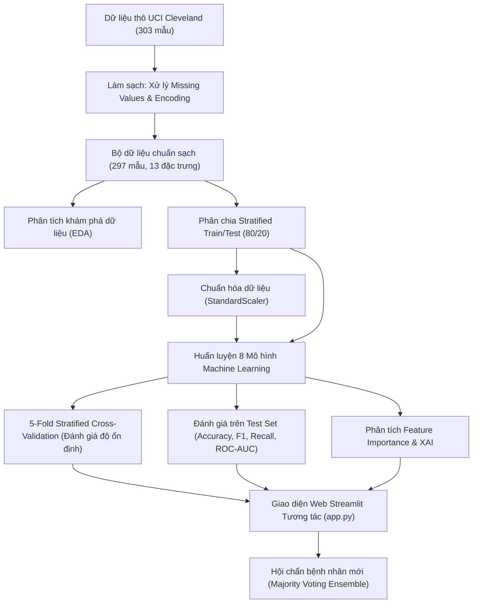

# 🫀 ĐỒ ÁN HỌC MÁY: HỆ THỐNG DỰ ĐOÁN & CHẨN ĐOÁN BỆNH TIM BẰNG 8 THUẬT TOÁN MACHINE LEARNING

> **Môn học:** Học Máy (Machine Learning)  
> **Đề tài:** Ứng dụng các thuật toán Học máy trong phân loại và chẩn đoán nguy cơ bệnh tim mạch dựa trên dữ liệu lâm sàng thực tế  
> **Bộ dữ liệu:** UCI Heart Disease (Cleveland Clinic Foundation - 297 bệnh nhân thực tế)  
> **Nền tảng triển khai:** Python 3.x, Scikit-Learn, XGBoost, Streamlit  

---

## 👥 PHÂN CHIA NHIỆM VỤ THÀNH VIÊN NHÓM (3 THÀNH VIÊN)

Dự án được phân bổ cân bằng và khoa học theo **3 trụ cột chuyên môn** nhằm đảm bảo mỗi thành viên phụ trách các trường phái thuật toán rõ ràng, hiểu sâu cơ chế toán học và làm chủ mô-đun mã nguồn tương ứng:

| STT | Thành Viên | Vai Trò (Role) | Thuật Toán Phụ Trách | Trách Nhiệm Mô-đun Hệ Thống | Tỉ Lệ Đóng Góp |
| :---: | :--- | :--- | :--- | :--- | :---: |
| 1 | **Thành viên 1** *(Nhóm trưởng)* | **Baseline & Linear-Probabilistic Architect** | 1. **Logistic Regression**<br>2. **Naive Bayes**<br>3. **Decision Tree** | • Pipeline dữ liệu chuẩn UCI & `StandardScaler`<br>• Module **🏠 Tổng Quan Dự Án**<br>• Module **📊 Khám Phá Dữ Liệu (EDA)** | **33.3%** |
| 2 | **Thành viên 2** | **Geometry, Kernel & Validation Lead** | 4. **K-Nearest Neighbors (KNN)**<br>5. **Support Vector Machine (SVM)**<br>6. **Gradient Boosting (GB)** | • Đánh giá kiểm định chéo **5-Fold Stratified CV**<br>• Biểu đồ phân tán sai số Boxplot qua các Folds<br>• Module **📈 Đường Cong ROC** & **🔢 Confusion Matrix** | **33.3%** |
| 3 | **Thành viên 3** | **Advanced Ensemble & Clinical AI Lead** | 7. **Random Forest (RF)**<br>8. **XGBoost (Extreme Boosting)**<br>9. **Majority Voting Ensemble** | • Phân tích **⭐ Feature Importance & XAI**<br>• Module **🩺 Chẩn Đoán Bệnh Nhân Mới** (Hội chẩn AI)<br>• Tổng hợp báo cáo học thuật & Slide bảo vệ | **33.4%** |

---

### 🔍 CHI TIẾT CÁC THUẬT TOÁN: MỤC ĐÍCH SỬ DỤNG, CƠ CHẾ VÀ VỊ TRÍ TRONG HỆ THỐNG

Dưới đây là bản mô tả chuyên sâu về **từng thuật toán được sử dụng để làm gì trong bài toán chẩn đoán bệnh tim**, cơ chế toán học xử lý dữ liệu lâm sàng, kết quả thực nghiệm và vị trí thể hiện cụ thể trong mã nguồn hệ thống:

---

#### 🧑‍💻 1. THÀNH VIÊN 1: NHÓM MÔ HÌNH TUYẾN TÍNH, XÁC SUẤT & CÂY NỀN TẢNG (DUY TÂN)

##### 1.1. Logistic Regression (LR - Hồi quy Logistic)
* **Thuật toán này sử dụng để làm gì trong đồ án?**
  * **Mô hình xác suất chuẩn mực y khoa (Clinical Baseline):** Trong nghiên cứu y học dịch tễ tim mạch, Logistic Regression là tiêu chuẩn vàng để ước tính trực tiếp xác suất mắc bệnh $P(\text{target}=1 \mid X) \in [0, 1]$ thay vì chỉ đưa ra nhãn cứng (0 hoặc 1).
  * **Định lượng tác động lâm sàng (Odds Ratios / Coefficients):** Thuật toán giúp trích xuất các trọng số chuẩn hóa $\beta_i$. Nhờ đó, bác sĩ có thể thấy định lượng: chỉ số nào làm **tăng nguy cơ** bệnh tim ($\beta > 0$ như độ chênh `oldpeak`, số mạch máu `ca`, loại đau ngực `cp`) và chỉ số nào mang tính **bảo vệ tim mạch** ($\beta < 0$ như nhịp tim tối đa `thalach` - nhịp tim khi gắng sức càng cao chứng tỏ cơ tim còn bù trừ tốt).
  * **Hỗ trợ điều chỉnh ngưỡng quyết định (Threshold Tuning):** Cung cấp xác suất liên tục để có thể dịch chuyển ngưỡng phân loại (ví dụ hạ ngưỡng từ 0.5 xuống 0.4 nhằm phát hiện sớm nhiều bệnh nhân hơn).
* **Cơ chế toán học & Hoạt động:**
  * Ánh xạ tổ hợp tuyến tính $z = \beta_0 + \sum_{i=1}^{13} \beta_i x_i$ qua hàm kích hoạt Sigmoid: $\sigma(z) = \frac{1}{1 + e^{-z}}$.
  * Tối ưu hóa hàm mất mát nhị phân Log-loss (Binary Cross-Entropy) bằng thuật toán tối ưu bậc hai giới hạn bộ nhớ **L-BFGS** với tối đa 1,000 vòng lặp (`max_iter=1000`).
* **Xử lý dữ liệu đặc thù:**
  * **Bắt buộc chuẩn hóa qua `StandardScaler`:** Do thuật toán tính tổng có trọng số $\beta_i x_i$, các biến có miền giá trị lớn (như Cholesterol 126–564 mg/dl) nếu không chuẩn hóa sẽ áp đảo hoàn toàn các biến có giá trị nhỏ (như Oldpeak 0–6.2 mm).
* **Kết quả thực nghiệm trên tập Cleveland:**
  * Test Accuracy: **85.00%** | 5-Fold CV Accuracy: **83.10% ± 6.44%** | ROC-AUC: **0.9531** *(Đạt AUC cao nhất trong cả 8 mô hình)* | Recall: **85.71%** | F1-Score: **84.21%**.
* **Vị trí thể hiện trong ứng dụng (`app.py`):**
  * Mã nguồn định nghĩa & huấn luyện: [`app.py` dòng 264 - 267](file:///d:/DoAnHocMay/app.py#L264-L267).
  * Trực quan hóa hệ số tác động: **Tab 3: `⭐ Tầm Quan Trọng Đặc Trưng`** ([`app.py` dòng 1145 - 1175](file:///d:/DoAnHocMay/app.py#L1145-L1175)) với biểu đồ thanh ngang hai chiều (màu Đỏ: tăng nguy cơ, màu Xanh: giảm nguy cơ).
  * Tham gia xếp hạng tại Tab 1, báo cáo chi tiết tại Tab 6 và đóng góp dự đoán tại Trang 4.
* **Đánh giá trong y tế:** Mô hình cực kỳ minh bạch (White-box model), không có rủi ro "hộp đen", được các hội đồng y khoa tin cậy cao nhất.

##### 1.2. Naive Bayes (Gaussian Naive Bayes)
* **Thuật toán này sử dụng để làm gì trong đồ án?**
  * **Sàng lọc ban đầu tức thì (Real-time Fast Screening):** Đóng vai trò là công cụ phân loại xác suất tốc độ cực cao (< 1ms). Phù hợp cho các kịch bản sàng lọc ban đầu tại trạm y tế cơ sở hoặc phân loại bệnh nhân cấp cứu trước khi có kết quả xét nghiệm chuyên sâu.
  * **Đo lường sự tích lũy của các triệu chứng độc lập:** Kiểm tra xem khi xem các triệu chứng tim mạch là các bằng chứng độc lập thì tổng hợp xác suất hậu nghiệm mang lại độ chính xác tới đâu. Trong đồ án, Naive Bayes gây bất ngờ khi đạt Test Accuracy cao nhất (**90.00%**), chứng minh 13 chỉ số của tập dữ liệu Cleveland kết hợp với nhau tạo ra bằng chứng chẩn đoán rất mạnh mẽ.
* **Cơ chế toán học & Hoạt động:**
  * Áp dụng định lý Bayes để tính xác suất hậu nghiệm:
    $$P(\text{Bệnh tim} \mid X) = \frac{P(\text{Bệnh tim}) \prod_{i=1}^{13} P(x_i \mid \text{Bệnh tim})}{P(X)}$$
  * Với các biến liên tục (tuổi, huyết áp, cholesterol...), thuật toán giả định tuân theo phân phối chuẩn Gaussian: $P(x_i \mid y) = \frac{1}{\sqrt{2\pi\sigma_y^2}} \exp\left(-\frac{(x_i - \mu_y)^2}{2\sigma_y^2}\right)$.
* **Xử lý dữ liệu đặc thù:**
  * Huấn luyện trên dữ liệu đã chuẩn hóa `StandardScaler` để các phân phối Gaussian thành phần có độ ổn định số học cao, tránh hiện tượng tràn số dưới (underflow).
* **Kết quả thực nghiệm trên tập Cleveland:**
  * Test Accuracy: **90.00%** *(Xếp Quán quân 🥇 trên tập kiểm thử)* | 5-Fold CV Accuracy: **80.17% ± 4.56%** | ROC-AUC: **0.9375** | Recall: **85.71%** | F1-Score: **88.89%**.
* **Vị trí thể hiện trong ứng dụng (`app.py`):**
  * Mã nguồn định nghĩa & huấn luyện: [`app.py` dòng 284 - 287](file:///d:/DoAnHocMay/app.py#L284-L287).
  * Hiển thị vị trí top 1 tại **Tab 1: `📊 Bảng So Sánh`**, tham gia vẽ đường cong ROC tại Tab 4 và đóng góp vào kết quả biểu quyết Trang 4.
* **Đánh giá trong y tế:** Độ nhạy (Recall) cao đạt 85.71% giúp giảm thiểu bỏ sót bệnh nhân, tốc độ tức thì; nhược điểm là giả định độc lập có điều kiện đôi khi bỏ qua tương tác phức tạp giữa tuổi và huyết áp.

##### 1.3. Decision Tree (Cây quyết định - Thuật toán CART)
* **Thuật toán này sử dụng để làm gì trong đồ án?**
  * **Mô phỏng phác đồ cây quyết định lâm sàng (Clinical Flowchart):** Bác sĩ thường khám bệnh theo sơ đồ phân nhánh nhị phân (ví dụ: *Có đau ngực không? $\rightarrow$ Nhịp tim gắng sức có $< 150$ không? $\rightarrow$ Đoạn ST có chênh xuống $> 1.5$ mm không?*). Decision Tree tự động sinh ra cây quyết định này từ dữ liệu thực tế.
  * **Cung cấp luật chẩn đoán trực quan (IF - THEN Rules):** Giúp nhân viên y tế đọc hiểu và kiểm chứng từng bước rẽ nhánh phân loại mà không cần kiến thức toán học phức tạp.
  * **Làm mô hình chuẩn đối chứng (Baseline Estimator) cho họ mô hình cây:** Chứng minh trực quan cho hội đồng thấy tại sao 1 cây đơn lẻ dễ bị giới hạn độ chính xác (đạt 71.67%) và tại sao nhóm cần phát triển lên Random Forest và XGBoost.
* **Cơ chế toán học & Hoạt động:**
  * Tại mỗi nút, thuật toán rà soát tất cả 13 biến và các ngưỡng cắt khả dĩ để tìm ra biến $j$ và ngưỡng $t$ tối đa hóa độ giảm bất thuần Gini:
    $$\Delta \text{Gini} = I_G(D) - \left( \frac{|D_L|}{|D|}I_G(D_L) + \frac{|D_R|}{|D|}I_G(D_R) \right), \quad I_G(D) = 1 - \sum_{k=0}^{1} p_k^2$$
  * Giới hạn `max_depth=5` và `random_state=42` để chặn hiện tượng cây mọc quá sâu gây học vẹt.
* **Xử lý dữ liệu đặc thù:**
  * Dùng trực tiếp dữ liệu thô (raw data), không cần chuẩn hóa thang đo vì phép so sánh ngưỡng $x_j \le t$ bất biến với các phép co giãn tuyến tính.
* **Kết quả thực nghiệm trên tập Cleveland:**
  * Test Accuracy: **71.67%** | 5-Fold CV Accuracy: **75.50% ± 3.87%** | ROC-AUC: **0.7204** | Recall: **57.14%** | F1-Score: **65.31%**.
* **Vị trí thể hiện trong ứng dụng (`app.py`):**
  * Mã nguồn định nghĩa & huấn luyện: [`app.py` dòng 268 - 271](file:///d:/DoAnHocMay/app.py#L268-L271).
  * Thể hiện tại Tab 1 Bảng So Sánh, Tab 3 (Split Feature Importance riêng cho Decision Tree), Tab 5 Confusion Matrix.
* **Đánh giá trong y tế:** Tính giải thích cao nhất nhưng độ nhạy thấp (Recall 57.14% - bỏ sót nhiều ca bệnh), chứng minh giá trị tất yếu của việc nâng cấp lên các kiến trúc Ensemble.

---

#### 🧑‍💻 2. THÀNH VIÊN 2: NHÓM MÔ HÌNH HÌNH HỌC, SIÊU PHẲNG KERNEL & KIỂM ĐỊNH CHÉO (QUỐC BẢO)

##### 2.1. K-Nearest Neighbors (KNN - K láng giềng gần nhất)
* **Thuật toán này sử dụng để làm gì trong đồ án?**
  * **Triển khai tư duy chẩn đoán dựa trên tiền lệ lâm sàng (Case-based Reasoning):** Khi tiếp nhận bệnh nhân mới, hệ thống truy xuất trong cơ sở dữ liệu quá khứ $k=5$ bệnh nhân có các chỉ số sinh hiệu (huyết áp, nhịp tim, cholesterol, điện tâm đồ) tương đồng nhất để đối chiếu kết quả.
  * **Khảo sát cấu trúc phân cụm cục bộ (Local Geometric Clustering):** Đánh giá xem trong không gian đa chiều, các ca bệnh tim có xu hướng cụm lại thành các vùng bệnh lý riêng biệt hay không.
* **Cơ chế toán học & Hoạt động:**
  * Tính toán khoảng cách hình học Euclidean trong không gian 13 chiều giữa bệnh nhân cần chẩn đoán $x$ và toàn bộ bệnh nhân trong tập huấn luyện $x^{(i)}$:
    $$d(x, x^{(i)}) = \sqrt{\sum_{j=1}^{13} (x_j - x_j^{(i)})^2}$$
  * Lấy đa số nhãn của $k=5$ láng giềng có khoảng cách nhỏ nhất (`n_neighbors=5`).
* **Xử lý dữ liệu đặc thù:**
  * **Bắt buộc chuẩn hóa 100% qua `StandardScaler`:** Nếu không chuẩn hóa, khoảng cách giữa 2 giá trị Cholesterol (chênh lệch 50–100 đơn vị) sẽ hoàn toàn chi phối khoảng cách giữa 2 giá trị Oldpeak (chênh lệch chỉ 0.5–1 đơn vị), làm sai lệch hoàn toàn khái niệm "láng giềng gần nhất".
* **Kết quả thực nghiệm trên tập Cleveland:**
  * Test Accuracy: **86.67%** *(Xếp Á quân 🥈 trên tập kiểm thử)* | 5-Fold CV Accuracy: **79.32% ± 7.73%** | ROC-AUC: **0.9358** | Recall: **82.14%** | F1-Score: **85.19%**.
* **Vị trí thể hiện trong ứng dụng (`app.py`):**
  * Mã nguồn định nghĩa & huấn luyện: [`app.py` dòng 272 - 275](file:///d:/DoAnHocMay/app.py#L272-L275).
  * Hiển thị vị trí top 2 tại **Tab 1: `📊 Bảng So Sánh`**, đóng góp phân tích phân bố Folds tại Tab 2 và tham gia biểu quyết tại Trang 4.
* **Đánh giá trong y tế:** Độ chính xác rất cao, trực quan; nhược điểm là chi phí tính toán tăng khi số lượng bệnh nhân lưu trữ lớn và nhạy cảm với các thuộc tính gây nhiễu.

##### 2.2. Support Vector Machine (SVM - Nhân RBF Kernel)
* **Thuật toán này sử dụng để làm gì trong đồ án?**
  * **Giải quyết ranh giới phân tách phi tuyến phức tạp:** Trong tim mạch học, ranh giới bệnh thường không thể cắt phẳng (ví dụ: huyết áp hơi cao kết hợp tuổi cao và nhịp tim giảm mới kích hoạt nguy cơ). SVM với nhân RBF uốn cong ranh giới để bao trọn các vùng bệnh lý phức tạp này.
  * **Tối đa hóa khoảng cách an toàn (Max-margin Classification):** Khác với các thuật toán chỉ tìm một đường phân chia bất kỳ, SVM tìm siêu phẳng có khoảng cách lề lớn nhất tới các ca bệnh ranh giới (Support Vectors). Điều này giúp hệ thống đạt độ bền vững (Robustness) cao nhất khi chẩn đoán bệnh nhân mới.
* **Cơ chế toán học & Hoạt động:**
  * Ánh xạ dữ liệu lên không gian Hilbert nhiều chiều thông qua hàm nhân Gaussian RBF (Radial Basis Function):
    $$K(x, x') = \exp\left(-\gamma \|x - x'\|^2\right)$$
  * Giải bài toán tối ưu hóa lồi có ràng buộc (Dual Quadratic Programming) để tìm các trọng số $\alpha_i$ định hình siêu phẳng: $f(x) = \text{sign}\left(\sum_{i=1}^{n} \alpha_i y_i K(x_i, x) + b\right)$. Cấu hình `probability=True` để tính xác suất qua phép hiệu chuẩn Platt Scaling.
* **Xử lý dữ liệu đặc thù:**
  * **Bắt buộc chuẩn hóa qua `StandardScaler`:** Hàm nhân RBF dựa trên chuẩn khoảng cách Euclidean bình phương $\|x - x'\|^2$, do đó thang đo không đồng nhất sẽ bóp méo không gian nhân.
* **Kết quả thực nghiệm trên tập Cleveland:**
  * Test Accuracy: **81.67%** | 5-Fold CV Accuracy: **81.43% ± 6.35%** | ROC-AUC: **0.9487** *(Đạt AUC cao thứ 2 toàn dự án)* | Recall: **78.57%** | F1-Score: **80.00%**.
* **Vị trí thể hiện trong ứng dụng (`app.py`):**
  * Mã nguồn định nghĩa & huấn luyện: [`app.py` dòng 276 - 279](file:///d:/DoAnHocMay/app.py#L276-L279).
  * Thể hiện đường cong ROC tiệm cận góc trên bên trái tại **Tab 4: `📈 Đường Cong ROC`** ([`app.py` dòng 1240 - 1275](file:///d:/DoAnHocMay/app.py#L1240-L1275)) và Tab 5 Confusion Matrix.
* **Đánh giá trong y tế:** Khả năng tổng quát hóa cực kỳ ấn tượng (ROC-AUC 0.9487), ít bị ảnh hưởng bởi số chiều; nhược điểm là bản chất toán học trừu tượng khó giải thích chi tiết từng biến số cho bệnh nhân.

##### 2.3. Gradient Boosting (GBM - Tăng cường độ dốc tuần tự)
* **Thuật toán này sử dụng để làm gì trong đồ án?**
  * **Cơ chế học sửa sai chuyên sâu cho các ca bệnh khó:** Trong tim mạch có những ca bệnh có triệu chứng mờ nhạt (ví dụ: đau ngực không triệu chứng nhưng chụp mạch vành lại bị tắc). Gradient Boosting tập trung huấn luyện các cây phía sau sửa chữa chính xác các ca bệnh mà các cây phía trước dự đoán sai.
  * **Mô hình đại diện cho trường phái Boosting cổ điển:** Tạo cơ sở khoa học để đối chiếu với XGBoost (phiên bản mở rộng có điều chuẩn hóa).
* **Cơ chế toán học & Hoạt động:**
  * Thuật toán huấn luyện tuần tự 100 cây quyết định (`n_estimators=100`, `learning_rate=0.1`). Tại mỗi bước $m$, mô hình tính phần dư giả (Pseudo-residuals) là đạo hàm riêng âm của hàm mất mát Log-loss:
    $$r_{im} = -\left[\frac{\partial L(y_i, F(x_i))}{\partial F(x_i)}\right]_{F=F_{m-1}} = y_i - \sigma(F_{m-1}(x_i))$$
  * Huấn luyện một cây con mới $h_m(x)$ để khớp với các phần dư $r_{im}$, sau đó cập nhật mô hình: $F_m(x) = F_{m-1}(x) + \eta h_m(x)$.
* **Xử lý dữ liệu đặc thù:**
  * Dùng trực tiếp dữ liệu thô (raw data), không bắt buộc chuẩn hóa.
* **Kết quả thực nghiệm trên tập Cleveland:**
  * Test Accuracy: **78.33%** | 5-Fold CV Accuracy: **78.02% ± 4.72%** *(Độ lệch chuẩn thấp chứng minh tính ổn định)* | ROC-AUC: **0.8873** | Recall: **75.00%** | F1-Score: **76.36%**.
* **Vị trí thể hiện trong ứng dụng (`app.py`):**
  * Mã nguồn định nghĩa & huấn luyện: [`app.py` dòng 288 - 293](file:///d:/DoAnHocMay/app.py#L288-L293).
  * Đóng góp số liệu vào **Tab 2: `🔄 Kiểm Định Chéo (Cross-Validation)`** ([`app.py` dòng 985 - 1105](file:///d:/DoAnHocMay/app.py#L985-L1105)) và đóng góp trọng số vào biểu đồ đồng thuận Feature Importance ở Tab 3.
* **Đánh giá trong y tế:** Độ ổn định qua 5 Folds rất cao (± 4.72%), học sâu các quan hệ phi tuyến; nhược điểm là tốc độ huấn luyện tuần tự và dễ bị quá khớp nếu số lượng cây quá lớn.

---

#### 🧑‍💻 3. THÀNH VIÊN 3: NHÓM MÔ HÌNH ENSEMBLE TỐI TÂN, GIẢI THÍCH AI & HỘI CHẨN LÂM SÀNG (HOÀNG BẢO)

##### 3.1. Random Forest (RF - Rừng ngẫu nhiên - Bagging Ensemble)
* **Thuật toán này sử dụng để làm gì trong đồ án?**
  * **Triệt tiêu hiện tượng Overfitting của cây đơn lẻ:** Khắc phục hoàn toàn sự bất ổn của Decision Tree bằng cách trung bình hóa kết quả của 100 cây quyết định độc lập, nâng độ chính xác từ 71.67% lên **83.33%**.
  * **Độ bền vững cao trước ngoại lai lâm sàng (Robustness to Outliers):** Khi gặp bệnh nhân có chỉ số bất thường (Cholesterol > 400 mg/dl), Random Forest nhờ cơ chế lấy mẫu ngẫu nhiên sẽ không bị kéo lệch dự đoán.
  * **Cung cấp độ đo Gini Feature Importance chuẩn xác:** Tính toán mức độ đóng góp của từng chỉ số y tế vào việc làm giảm độ bất thuần, phục vụ tính minh bạch của hệ thống AI.
* **Cơ chế toán học & Hoạt động:**
  * Áp dụng kỹ thuật **Bootstrap Aggregation (Bagging)**: Lấy mẫu ngẫu nhiên có hoàn lại $N$ mẫu bệnh nhân cho mỗi cây.
  * Áp dụng kỹ thuật **Random Feature Subspace**: Tại mỗi nút phân nhánh, chỉ xét một tập con ngẫu nhiên gồm $m = \sqrt{13} \approx 3-4$ đặc trưng để phân nhánh. Điều này làm giảm tương quan (Decorrelation) giữa các cây, giúp phương sai tổng thể của cả rừng giảm mạnh: $\text{Var}(\bar{X}) = \rho \sigma^2 + \frac{1-\rho}{B}\sigma^2$.
  * Dự đoán cuối cùng bằng bỏ phiếu đa số hoặc trung bình xác suất của 100 cây: $\hat{P}(y=1 \mid x) = \frac{1}{100} \sum_{t=1}^{100} P_t(y=1 \mid x)$.
* **Xử lý dữ liệu đặc thù:**
  * Huấn luyện trên dữ liệu thô (raw data), không cần chuẩn hóa thang đo.
* **Kết quả thực nghiệm trên tập Cleveland:**
  * Test Accuracy: **83.33%** | 5-Fold CV Accuracy: **79.74% ± 6.82%** | ROC-AUC: **0.9364** | Recall: **75.00%** | F1-Score: **80.77%**.
* **Vị trí thể hiện trong ứng dụng (`app.py`):**
  * Mã nguồn định nghĩa & huấn luyện: [`app.py` dòng 280 - 283](file:///d:/DoAnHocMay/app.py#L280-L283).
  * Đóng góp trọng số nòng cốt trong **Tab 3: `⭐ Tầm Quan Trọng Đặc Trưng`** ([`app.py` dòng 1110 - 1235](file:///d:/DoAnHocMay/app.py#L1110-L1235)) và tham gia chẩn đoán tại Trang 4.
* **Đánh giá trong y tế:** Là mô hình học máy dạng bảng cân bằng nhất giữa độ chính xác, độ ổn định và khả năng trích xuất đặc trưng quan trọng; nhược điểm là cấu trúc 100 cây khó vẽ ra giấy cho bác sĩ đọc từng cây.

##### 3.2. XGBoost (Extreme Gradient Boosting)
* **Thuật toán này sử dụng để làm gì trong đồ án?**
  * **Đại diện cho mô hình State-of-the-art (SOTA) mạnh nhất:** Đưa công nghệ học máy tối tân nhất hiện nay vào đồ án chẩn đoán bệnh tim mạch.
  * **Tối ưu hóa có phạt điều chuẩn (Regularized Learning):** Khác với Gradient Boosting thông thường, XGBoost tích hợp sẵn hàm phạt L1 ($\alpha$) và L2 ($\lambda$) lên trọng số các nút lá để triệt tiêu tình trạng học vẹt trên dữ liệu y tế quy mô nhỏ.
  * **Đo lường độ lợi thông tin (Gain Importance):** Tính toán chính xác mỗi chỉ số tim mạch giúp cải thiện hàm mục tiêu trung bình bao nhiêu phần trăm.
* **Cơ chế toán học & Hoạt động:**
  * Khai triển Taylor bậc 2 của hàm mất mát có điều chuẩn:
    $$\mathcal{L}^{(t)} \approx \sum_{i=1}^{n} \left[ L(y_i, \hat{y}_i^{(t-1)}) + g_i f_t(x_i) + \frac{1}{2} h_i f_t^2(x_i) \right] + \gamma T + \frac{1}{2}\lambda \sum_{j=1}^{T} w_j^2$$
    Trong đó $g_i = \partial_{\hat{y}^{(t-1)}} L$ (Gradient) và $h_i = \partial_{\hat{y}^{(t-1)}}^2 L$ (Hessian).
  * Trọng số tối ưu tại mỗi lá được giải giải tích: $w_j^* = -\frac{\sum_{i \in I_j} g_i}{\sum_{i \in I_j} h_i + \lambda}$, và điểm số phân nhánh (Gain) được tính toán chính xác để chọn ngưỡng cắt.
  * Cấu hình dự án: `n_estimators=100`, `learning_rate=0.1`, `max_depth=4`, `eval_metric="logloss"`.
* **Xử lý dữ liệu đặc thù:**
  * Dữ liệu thô (raw data), thuật toán tự động xử lý và tối ưu hóa trên cấu trúc cây nhị phân.
* **Kết quả thực nghiệm trên tập Cleveland:**
  * Test Accuracy: **83.33%** | 5-Fold CV Accuracy: **78.88% ± 6.91%** | ROC-AUC: **0.9051** | Recall: **78.57%** | F1-Score: **81.48%**.
* **Vị trí thể hiện trong ứng dụng (`app.py`):**
  * Mã nguồn định nghĩa & huấn luyện: [`app.py` dòng 294 - 303](file:///d:/DoAnHocMay/app.py#L294-L303).
  * Thể hiện tại Tab 1 Bảng So Sánh, Tab 3 (Gain Feature Importance), Tab 4 ROC Curves, Trang 4 Chẩn đoán.
* **Đánh giá trong y tế:** Tốc độ thực thi cực nhanh, độ chính xác cao và khả năng kháng nhiễu tốt nhờ cơ chế điều chuẩn; nhược điểm là đòi hỏi tinh chỉnh nhiều siêu tham số.

##### 3.3. Majority Voting Ensemble (Thuật toán Biểu quyết đa số kết hợp 8 mô hình)
* **Thuật toán này sử dụng để làm gì trong đồ án?**
  * **Mô phỏng "Hội đồng hội chẩn đa chuyên khoa" (Multi-disciplinary Medical Consultation):** Trong bệnh viện, các ca bệnh tim phức tạp không bao giờ do 1 bác sĩ quyết định mà thông qua hội chẩn của hội đồng. 8 thuật toán đại diện cho 8 góc nhìn toán học khác nhau (Tuyến tính, Xác suất, Hình học láng giềng, Siêu phẳng lề cực đại, Cây phân nhánh, Bagging, Boosting).
  * **Giảm thiểu tối đa ca bỏ sót bệnh nhân (False Negatives):** Sai sót nguy hiểm nhất trong y tế là người có bệnh mà chẩn đoán nhầm thành an toàn (False Negative). Khi một vài mô hình bị "đánh lừa" bởi các chỉ số lạ, các mô hình còn lại vẫn phát hiện và đưa ra cảnh báo kịp thời cho bệnh nhân.
  * **Tích hợp bộ lọc an toàn sinh học (Input Boundary Safety Check):** Đưa ra cảnh báo đỏ ngay lập tức nếu các chỉ số sinh hiệu vượt ngưỡng cấp cứu y tế (Huyết áp > 180 mmHg, Cholesterol > 350 mg/dl, Nhịp tim > 205 bpm).
* **Cơ chế toán học & Hoạt động:**
  * **Biểu quyết nhị phân theo quy tắc đa số cứng (Hard Voting):**
    $$\hat{y}_{\text{Ensemble}} = \begin{cases} 1 & \text{nếu } \sum_{m=1}^{8} \hat{y}_m \ge 5 \\ 0 & \text{ngược lại} \end{cases}$$
  * **Xác suất nguy cơ tim mạch tổng hợp trung bình (Soft Consensus Probability):**
    $$\bar{P}(\text{Nguy cơ}) = \frac{1}{8} \sum_{m=1}^{8} P_m(\text{Bệnh tim} \mid X)$$
* **Xử lý dữ liệu đặc thù:**
  * Tiếp nhận 13 chỉ số từ Form giao diện người dùng, đồng thời đưa qua 2 luồng: luồng thô (cho Tree models) và luồng chuẩn hóa `scaler.transform()` (cho Linear, Distance, Kernel models).
* **Kết quả thực nghiệm trên giao diện:**
  * Cung cấp kết luận phân lớp nhị phân kèm tỷ lệ xác suất nguy cơ từ $0\%$ đến $100\%$ và hiển thị biểu đồ thanh trực quan hóa dự đoán của từng thuật toán.
* **Vị trí thể hiện trong ứng dụng (`app.py`):**
  * Trọng tâm toàn bộ Trang **`🩺 Chẩn Đoán Bệnh Nhân Mới`** ([`app.py` dòng 1400 - 1625](file:///d:/DoAnHocMay/app.py#L1400-L1625)).
* **Đánh giá trong y tế:** Độ tin cậy lâm sàng cao nhất, hạn chế tối đa rủi ro chẩn đoán sai của từng thuật toán đơn lẻ, mang tính thực tiễn cao khi triển khai tại các phòng khám hỗ trợ bác sĩ.

---

### 🎤 KỊCH BẢN THUYẾT TRÌNH BẢO VỆ ĐỒ ÁN (15 PHÚT)

```text
[00:00 - 04:00] THÀNH VIÊN 1:
├── Đặt vấn đề và tính cấp thiết của việc phát hiện sớm bệnh tim mạch bằng ML.
├── Mô tả dữ liệu thực tế UCI Cleveland (297 bệnh nhân, 13 chỉ số sinh hiệu).
├── Trình bày 3 mô hình nền tảng: Logistic Regression, Naive Bayes, Decision Tree.
└── Demo nhanh giao diện Trang 1 (Tổng Quan) và Trang 2 (Khám Phá Dữ Liệu EDA).

[04:00 - 09:00] THÀNH VIÊN 2:
├── Trình bày 3 thuật toán hình học & tối ưu: KNN, SVM (Kernel RBF), Gradient Boosting.
├── Phân tích quy trình kiểm định chéo 5-Fold Stratified Cross-Validation để kiểm tra tính ổn định.
├── Demo Tab 1 (Bảng So Sánh), Tab 2 (Boxplot Folds) và Tab 4 (ROC Curves).
└── Giải thích lý do Recall quan trọng hơn Accuracy trong bài toán y khoa.

[09:00 - 14:00] THÀNH VIÊN 3:
├── Trình bày 2 thuật toán Ensemble tối tân: Random Forest và XGBoost.
├── Phân tích Explainable AI (XAI) qua Feature Importance và các chỉ số tim mạch then chốt.
├── Demo trực tiếp Trang 4: Nhập thử 1 ca bệnh nhân lâm sàng, kiểm tra bộ cảnh báo an toàn sinh hiệu và cơ chế Biểu quyết đa số (Majority Voting).
└── Kết luận đồ án và định hướng mở rộng.

[14:00 - 15:00] TOÀN BỘ NHÓM:
└── Lắng nghe câu hỏi và trả lời phản biện trước hội đồng giảng viên.
```

---

## 📁 CẤU TRÚC THƯ MỤC DỰ ÁN

```text
DoAnHocMay/
├── app.py             # Ứng dụng web Streamlit tương tác chính (4 trang, 8 mô hình)
├── heart.csv          # Dữ liệu lâm sàng thực tế UCI Cleveland (297 bệnh nhân, 14 thuộc tính)
├── requirements.txt   # Danh sách các thư viện phụ thuộc của dự án
├── README.md          # Tài liệu tổng quan, hướng dẫn triển khai & báo cáo đồ án
└── .vscode/
    └── settings.json  # Cấu hình môi trường Python Workspace
```

---

## 🔄 QUY TRÌNH HỌC MÁY TOÀN DIỆN (PIPELINE ARCHITECTURE)



---

## 🤖 8 THUẬT TOÁN HỌC MÁY ĐƯỢC TRIỂN KHAI

| STT | Thuật Toán | Ký Hiệu | Nhóm Thuật Toán | Nguyên Lý Toán Học Cốt Lõi | Chuẩn Hóa (`StandardScaler`) |
| :---: | :--- | :---: | :--- | :--- | :---: |
| 1 | **Logistic Regression** | `LR` | Tuyến tính / Xác suất | Hàm Sigmoid biến đổi tổ hợp tuyến tính thành xác suất $[0, 1]$ | ✅ Bắt buộc |
| 2 | **Decision Tree** | `DT` | Cây quyết định | Phân nhánh tối ưu dựa trên chỉ số Gini Impurity hoặc Entropy | ❌ Không cần |
| 3 | **K-Nearest Neighbors** | `KNN` | Dựa trên khoảng cách | Phân lớp theo đa số $k$ láng giềng gần nhất (Khoảng cách Euclidean) | ✅ Bắt buộc |
| 4 | **Support Vector Machine** | `SVM` | Siêu phẳng phân tách | Tìm siêu phẳng tối đa hóa lề (Margin) với hàm nhân phi tuyến RBF | ✅ Bắt buộc |
| 5 | **Random Forest** | `RF` | Bagging Ensemble | Kết hợp nhiều cây quyết định độc lập qua kỹ thuật Bootstrap Aggregation | ❌ Không cần |
| 6 | **Naive Bayes** | `NB` | Xác suất Bayes | Định lý Bayes giả định các đặc trưng độc lập có điều kiện (Gaussian NB) | ✅ Khuyến nghị |
| 7 | **Gradient Boosting** | `GB` | Boosting Ensemble | Huấn luyện tuần tự các cây quyết định để sửa lỗi sai của cây trước | ❌ Không cần |
| 8 | **XGBoost** | `XGB` | Extreme Boosting | Tối ưu hóa gradient bậc hai (Hessian) kèm điều chuẩn hóa chống quá khớp | ❌ Không cần |

---

## 📋 MÔ TẢ 13 CHỈ SỐ LÂM SÀNG (CLEVELAND CLINICAL FEATURES)

Dữ liệu gốc từ **Bệnh viện Cleveland (Hoa Kỳ)**, đã được mã hóa theo chuẩn y tế:

| Tên Cột | Tên Y Khoa | Định Nghĩa & Miền Giá Trị | Đơn Vị |
| :--- | :--- | :--- | :---: |
| `age` | Tuổi | Tuổi của bệnh nhân khi khám | Năm (29 - 77) |
| `sex` | Giới tính | 1 = Nam; 0 = Nữ | Phân loại |
| `cp` | Loại đau thắt ngực (Chest Pain) | 0: Đau thắt ngực điển hình (Typical Angina)<br>1: Đau thắt ngực không điển hình (Atypical Angina)<br>2: Đau không do tim (Non-anginal Pain)<br>3: Không có triệu chứng đau (Asymptomatic) | 0 - 3 |
| `trestbps` | Huyết áp lúc nghỉ | Huyết áp tâm thu đo lúc nhập viện | mm Hg |
| `chol` | Cholesterol huyết thanh | Nồng độ Cholesterol trong máu | mg/dl |
| `fbs` | Đường huyết lúc đói | Đường huyết > 120 mg/dl (1 = Đúng; 0 = Sai) | Nhị phân (0/1) |
| `restecg` | Điện tâm đồ lúc nghỉ | 0: Bình thường<br>1: Bất thường sóng ST-T<br>2: Phì đại thất trái theo tiêu chuẩn Estes | 0 - 2 |
| `thalach` | Nhịp tim tối đa | Nhịp tim cao nhất đạt được trong nghiệm pháp gắng sức | bpm (71 - 202) |
| `exang` | Đau ngực khi gắng sức | 1 = Xuất hiện cơn đau; 0 = Không | Nhị phân (0/1) |
| `oldpeak` | Độ chênh ST (ST Depression) | Độ chênh xuống của đoạn ST do gắng sức so với lúc nghỉ | mm (0.0 - 6.2) |
| `slope` | Độ dốc đoạn ST đỉnh | 0: Dốc lên (Upsloping); 1: Phẳng (Flat); 2: Dốc xuống (Downsloping) | 0 - 2 |
| `ca` | Số mạch máu lớn | Số nhánh động mạch vành chính được soi thấy qua xạ hình huỳnh quang | 0 - 3 |
| `thal` | Xạ hình tưới máu tim (Thallium) | 1: Khuyết tật cố định (Fixed Defect)<br>2: Tuần hoàn bình thường (Normal)<br>3: Khuyết tật có thể hồi phục (Reversible Defect) | 1 - 3 |
| **`target`** | **Tình trạng bệnh tim** | **0: Không có bệnh (< 50% hẹp mạch vành)**<br>**1: Mắc bệnh tim (≥ 50% đường kính hẹp động mạch vành)** | **0 / 1** |

---

## 🌟 TÍNH NĂNG NỔI BẬT TRONG ỨNG DỤNG STREAMLIT

Ứng dụng web [`app.py`](file:///d:/DoAnHocMay/app.py) được thiết kế hiện đại với 4 mô-đun chính:

### 1. 🏠 Tổng Quan Dự Án
- Trực quan hóa số liệu tổng thể (297 bệnh nhân, 13 thuộc tính sinh hiệu, 8 thuật toán ML).
- Bảng tổng hợp thuật toán và sơ đồ 6 bước quy trình học máy chuẩn y tế.
- Bảng tra cứu định nghĩa y khoa chi tiết của từng chỉ số.

### 2. 📊 Khám Phá & Phân Tích Dữ Liệu Lâm Sàng (EDA)
- **Tổng quan dữ liệu:** Thống kê mô tả 5 số (`mean`, `std`, `min`, `IQR`, `max`), kiểm tra giá trị khuyết thiếu.
- **Phân bố nhãn mục tiêu:** Biểu đồ cột và tròn về tỷ lệ mắc bệnh tim (53.9% âm tính, 46.1% dương tính - tỷ lệ cân bằng tự nhiên).
- **Phân bố đa biến:** Lựa chọn đặc trưng động để vẽ Histogram so sánh giữa nhóm bệnh và nhóm không bệnh.
- **Ma trận tương quan (Correlation Heatmap):** Phân tích hệ số tương quan Pearson giữa tất cả các cặp chỉ số và tương quan trực tiếp với `target`.
- **Boxplot & Pairplot:** So sánh độ biến thiên và phân nhóm ranh giới quyết định.

### 3. 🤖 Huấn Luyện, Đánh Giá & Thẩm Định 8 Mô Hình ML
- **Bảng xếp hạng tổng hợp:** Xếp hạng đồng thời Test Accuracy, 5-Fold CV Accuracy ($\mu \pm \sigma$), ROC-AUC, Precision, Recall và F1-Score.
- **Biểu đồ so sánh Overfitting:** Trực quan hóa song song giữa *Test Set Accuracy* và *5-Fold CV Mean*.
- **Kiểm định chéo (5-Fold Stratified CV):** 
  - Biểu đồ **Boxplot & Stripplot** biểu diễn phân bố điểm số qua 5 Folds cho cả 8 mô hình.
  - Bảng số liệu chi tiết từng Fold từ **Fold 1 đến Fold 5** và độ lệch chuẩn ($\pm \sigma$).
- **Tầm quan trọng đặc trưng (Feature Importance & Explainable AI):**
  - Đồng thuận Ensemble từ **Random Forest + Gradient Boosting + XGBoost**.
  - Hệ số hồi quy tuyến tính chuẩn hóa của **Logistic Regression** (phân biệt màu đỏ: yếu tố làm tăng nguy cơ bệnh, màu xanh: yếu tố bảo vệ làm giảm nguy cơ).
  - Phân tích lâm sàng y khoa cho Top 5 đặc trưng: `cp`, `thalach`, `oldpeak`, `ca`, `thal`.
- **Đường cong ROC đa mô hình (ROC Curves):** So sánh chỉ số AUC trên cùng hệ trục.
- **Ma trận nhầm lẫn (Confusion Matrix Grid):** Quan sát trực quan số ca True Positive, False Negative.
- **Hồ sơ chi tiết (Classification Report):** Xem chi tiết từng chỉ số cho từng thuật toán.

### 4. 🩺 Chẩn Đoán Bệnh Nhân Mới (Hội Chẩn AI)
- Form nhập liệu 13 chỉ số sinh hiệu trực quan, thân thiện.
- **Kiểm tra an toàn ngưỡng sinh học (Input Boundary Safety Check):** Cảnh báo tự động các mức huyết áp, cholesterol nguy hiểm.
- Dự đoán đồng thời với cả 8 mô hình ML.
- **Biểu quyết đa số (Majority Voting Ensemble):** Đưa ra kết luận hội chẩn, tính toán tỷ lệ xác suất nguy cơ trung bình (%) và khuyến nghị y tế.

---

## 🚀 HƯỚNG DẪN CÀI ĐẶT & CHẠY ỨNG DỤNG

### Bước 1: Mở Terminal tại thư mục dự án
```powershell
cd d:\DoAnHocMay
```

### Bước 2: Cài đặt các thư viện cần thiết
```powershell
pip install -r requirements.txt
```

### Bước 3: Khởi chạy ứng dụng Streamlit
```powershell
streamlit run app.py
```
*(Nếu trên máy có nhiều phiên bản Python, bạn có thể chạy bằng đường dẫn Python cụ thể):*
```powershell
& "C:\Program Files (x86)\Microsoft Visual Studio\Shared\Python39_64\python.exe" -m streamlit run app.py
```

### Bước 4: Trải nghiệm ứng dụng
Trình duyệt sẽ tự động mở tại địa chỉ: **`http://localhost:8501`**

---

## 📊 BẢNG KẾT QUẢ THỰC NGHIỆM ĐỒ ÁN (TRÊN TẬP UCI CLEVELAND)

| Thứ Hạng | Thuật Toán | Thành Viên Phụ Trách | Test Accuracy | 5-Fold CV Accuracy | ROC-AUC | Recall | F1-Score |
| :---: | :--- | :---: | :---: | :---: | :---: | :---: | :---: |
| 🥇 | **Naive Bayes** | Thành viên 1 | **90.00%** | **80.17% ± 4.56%** | **0.9375** | **85.71%** | **88.89%** |
| 🥈 | **K-Nearest Neighbors** | Thành viên 2 | **86.67%** | **79.32% ± 7.73%** | **0.9358** | **82.14%** | **85.19%** |
| 🥉 | **Logistic Regression** | Thành viên 1 | **85.00%** | **83.10% ± 6.44%** | **0.9531** | **85.71%** | **84.21%** |
| 4 | **Random Forest** | Thành viên 3 | **83.33%** | **79.74% ± 6.82%** | **0.9364** | **75.00%** | **80.77%** |
| 5 | **XGBoost** | Thành viên 3 | **83.33%** | **78.88% ± 6.91%** | **0.9051** | **78.57%** | **81.48%** |
| 6 | **Support Vector Machine** | Thành viên 2 | **81.67%** | **81.43% ± 6.35%** | **0.9487** | **78.57%** | **80.00%** |
| 7 | **Gradient Boosting** | Thành viên 2 | **78.33%** | **78.02% ± 4.72%** | **0.8873** | **75.00%** | **76.36%** |
| 8 | **Decision Tree** | Thành viên 1 | **71.67%** | **75.50% ± 3.87%** | **0.7204** | **57.14%** | **65.31%** |

---

## 💡 ĐỊNH HƯỚNG PHÁT TRIỂN TIẾP THEO

- [ ] Thu thập và tích hợp thêm các bộ dữ liệu từ Hungary, Switzerland, Long Beach để tăng kích thước mẫu lên > 1,000 bệnh nhân.
- [ ] Thử nghiệm kỹ thuật xử lý mất cân bằng dữ liệu như **SMOTE** (Synthetic Minority Over-sampling Technique).
- [ ] Tích hợp mô hình mạng nơ-ron nhân tạo (Multilayer Perceptron - MLP / PyTorch).
- [ ] Tinh chỉnh ngưỡng quyết định (Threshold Tuning) để tối đa hóa chỉ số **Recall** nhằm giảm thiểu tối đa ca bỏ sót bệnh nhân trong y tế (False Negatives).
